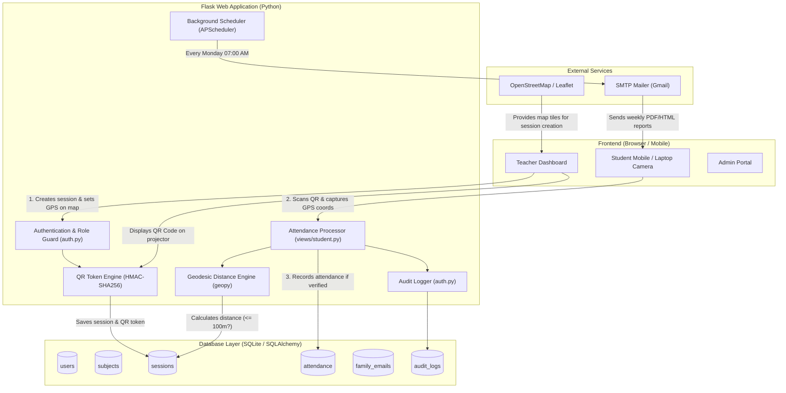
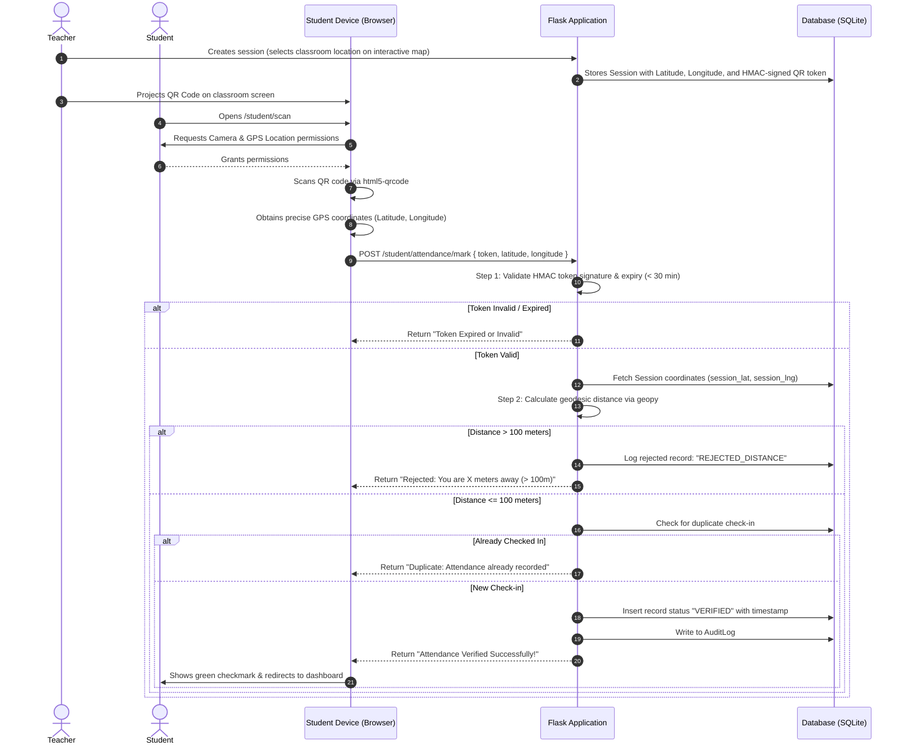

# Smart Attendance System: Complete College Project Context & Viva Guide

---

## 1. Project Overview & Abstract

### 1.1 Project Title
**Smart Attendance System with Dynamic QR Code Verification & GPS Geolocation Tracking**

### 1.2 Abstract
Traditional attendance recording in universities and colleges faces multiple challenges: time-consuming manual roll calls, paper record degradation, and the widespread practice of **proxy attendance** ("buddy punching" where students sign or check-in on behalf of absent peers).

This project presents a web-based automated attendance management system built with **Python (Flask)**. The core innovation combines two independent verification factors:
1. **Cryptographically Secure QR Code Scanning**: Teachers generate unique class sessions with dynamic, time-limited, HMAC-SHA256 signed QR codes.
2. **GPS Geolocation Verification (Geofencing)**: Using the HTML5 Geolocation API and Python's `geopy` library, the server calculates the exact geodesic distance between the classroom's coordinates and the student's physical location. Attendance is verified **only if the student is physically within a 100-meter radius** of the classroom.

The platform provides role-based access for **Administrators**, **Teachers/Employees**, and **Students**, complete with automated weekly email reports to parents and students, custom anti-bot CAPTCHA protection, and comprehensive audit logs.

---

## 2. The Problem It Solves

| Problem in Traditional System | How This Project Solves It |
| :--- | :--- |
| **Proxy Attendance / Buddy Punching** | A student sitting at home or in a cafeteria cannot mark attendance. Even if a classmate forwards them a picture of the QR code, the GPS verification will detect they are not within the 100m classroom boundary and **automatically reject** the attempt. |
| **Reusing Old QR Codes** | QR code tokens are embedded with a timestamp and an HMAC digital signature. Once expired (30 minutes default) or scanned for a different session, the server flags it as invalid. |
| **Wasted Lecture Time** | Taking roll call for 60+ students manually consumes 10-15 minutes per lecture. With this system, the teacher displays the QR on a projector; all students scan simultaneously within 30 seconds. |
| **Lack of Student & Parent Awareness** | An automated background scheduler (APScheduler) generates weekly attendance summaries and automatically emails both the student and their registered family contacts every Monday morning. |
| **Data Tampering & Accountability** | Every sensitive action (logins, failed attempts, attendance scans, password resets) is recorded in an immutable **Audit Log** table with IP addresses and timestamps. |

---

## 3. System Architecture & Workflow

### 3.1 Architectural Diagram



---

### 3.2 The Life of an Attendance Scan (Step-by-Step)



---

## 4. Key Modules & Features Explained

### 4.1 Multi-Role User Management
The system segregates permissions strictly via role-based access decorators (`@role_required`):
1. **Administrator (`admin`)**:
   - Access URL: `/auth/admin`
   - Can create, edit, filter, and deactivate users (Students, Teachers, Admins).
   - Can create subjects, assign teachers, schedule sessions.
   - Full access to audit logs with filtering and clearing capabilities.
   - Manual triggering of scheduled email jobs for testing.
2. **Teacher / Faculty (`employee`)**:
   - Access URL: `/login/employee`
   - Views their assigned subjects.
   - Schedules class sessions by clicking on an interactive OpenStreetMap to pin the class location.
   - Displays real-time session QR codes.
   - Views real-time rosters of students who have checked in.
   - Exports complete attendance data to CSV spreadsheets.
3. **Student (`undergraduate` & `postgraduate`)**:
   - Access URL: `/login/undergraduate`
   - Daily attendance dashboard (shows classes attended vs missed today).
   - Weekly attendance dashboard (with attendance percentage breakdown).
   - Real-time camera scanner (`/student/scan`) with automatic GPS capture.

### 4.2 Security & Fraud Prevention Mechanisms
- **Cryptographic HMAC QR Tokens**: The QR code data is not plain text like `session_123`. It is an HMAC-SHA256 signature calculated using the application's secret key:
  $$\text{Token} = \text{Base64}\Big(\text{session\_id} \parallel \text{timestamp} \parallel \text{HMAC-SHA256}(\text{session\_id} \parallel \text{timestamp}, \text{SECRET\_KEY})\Big)$$
  Students cannot guess or forge a QR token for future classes.
- **Geodesic Distance Verification**: Uses the WGS-84 ellipsoidal model (via `geopy.distance.geodesic`) rather than simple Euclidean distance, guaranteeing sub-meter physical accuracy across the globe.
- **DDoS & Brute Force Rate Limiting**: Powered by `Flask-Limiter` (`10 login attempts per minute`, `200 requests per day`).
- **Custom Anti-Bot CAPTCHA**: Built-in image distortion engine using `Pillow` creates dynamic verification codes on login pages to stop automated credential stuffing.
- **Password Security**: Strong hashing with salt via Werkzeug's PBKDF2/SHA256 implementation. Never stored in plain text.
- **Comprehensive Audit Logging**: Tracks every security-relevant event: logins, failed logins, attendance verification outcomes, and password modifications.

### 4.3 Automated Background Scheduling & Notification
- Uses **APScheduler** running inside Flask.
- Runs every Monday morning at 07:00 AM automatically.
- Compiles a weekly summary of attended vs missed lectures for every active student.
- Sends formatted emails to both the student's email and registered parent/guardian emails (`family_emails` table).

---

## 5. Technology Stack Summary

| Layer | Technology | Why It Was Chosen |
| :--- | :--- | :--- |
| **Backend Framework** | **Flask 3.0 (Python 3.11+)** | Lightweight, highly modular, fast execution, excellent blueprint routing structure. |
| **Database** | **SQLite (Dev) / PostgreSQL (Prod)** | SQLite requires zero configuration, perfect for local college demonstrations and grading. |
| **ORM** | **SQLAlchemy + Flask-SQLAlchemy** | Object-Relational Mapping abstracts SQL queries into Python classes, preventing SQL injection. |
| **Frontend Styling** | **TailwindCSS + Jinja2** | Responsive, modern utility-first CSS framework that scales perfectly to mobile screens. |
| **In-Browser QR Scanner** | **html5-qrcode** | Pure JavaScript browser scanner that accesses webcams and phone cameras without external plugins. |
| **Interactive Maps** | **Leaflet.js + OpenStreetMap** | Open-source, lightweight map interface allowing teachers to visually select classroom GPS coordinates. |
| **Geodesic Calculation** | **geopy** | Calculates accurate geodesic distances over Earth's curvature. |
| **Job Scheduling** | **APScheduler** | Robust in-process scheduler for background jobs (automated weekly reports). |

---

## 6. Database Schema Details

```
+---------------------------------------------------------------------------------+
|                                 DATABASE TABLES                                 |
+---------------------------------------------------------------------------------+

1. users
   ├── id (Integer, Primary Key)
   ├── email (String, Unique)
   ├── password_hash (String)
   ├── role ('admin', 'employee', 'undergraduate', 'postgraduate')
   ├── full_name (String)
   ├── student_id (String, Unique)
   ├── phone, department, year
   └── force_password_reset, is_active, created_at

2. subjects
   ├── id (Integer, Primary Key)
   ├── name (String) - e.g., 'Data Structures & Algorithms'
   ├── code (String, Unique) - e.g., 'CS-201'
   ├── description (Text)
   ├── teacher_id (Foreign Key -> users.id)
   └── is_active, created_at

3. sessions
   ├── id (Integer, Primary Key)
   ├── subject_id (Foreign Key -> subjects.id)
   ├── teacher_id (Foreign Key -> users.id)
   ├── location_lat (Float) - GPS Latitude of class
   ├── location_lng (Float) - GPS Longitude of class
   ├── location_name (String) - e.g., 'Lab 3, CS Block'
   ├── start_time, end_time (DateTime)
   ├── qr_token (String, Unique, HMAC-protected)
   └── is_active, notes

4. attendance
   ├── id (Integer, Primary Key)
   ├── student_id (Foreign Key -> users.id)
   ├── session_id (Foreign Key -> sessions.id)
   ├── subject_id (Foreign Key -> subjects.id)
   ├── student_lat, student_lng (Float) - Student's coordinates at scan time
   ├── distance_meters (Float) - Calculated distance from classroom
   ├── verification_status ('VERIFIED', 'REJECTED_DISTANCE', 'REJECTED_DUPLICATE')
   ├── timestamp (DateTime)
   └── UNIQUE CONSTRAINT: (student_id, session_id) -> Prevents double check-in

5. family_emails
   ├── id (Integer, Primary Key)
   ├── student_id (Foreign Key -> users.id)
   ├── email (String)
   └── relationship ('mother', 'father', 'guardian')

6. audit_logs
   ├── id (Integer, Primary Key)
   ├── user_id (Foreign Key -> users.id)
   ├── action (String) - e.g., 'ADMIN_LOGIN', 'ATTENDANCE_MARKED'
   ├── details (Text)
   ├── ip_address (String)
   └── timestamp (DateTime)
```

---

## 7. Demo Accounts Reference Sheet

| Role | Portal URL | Email | Password |
| :--- | :--- | :--- | :--- |
| **System Admin** | `/auth/admin` | `admin@school.test` | `Test1234!` |
| **Default Admin (Fresh DB)** | `/auth/admin` | `admin@neduet.edu.pk` | `admin123` |
| **Faculty / Teacher 1** | `/login/employee` | `employee@school.test` | `Test1234!` |
| **Faculty / Teacher 2** | `/login/employee` | `employee2@school.test` | `Test1234!` |
| **Student 1** | `/login/undergraduate` | `student1@school.test` | `Test1234!` |
| **Student 2** | `/login/undergraduate` | `student2@school.test` | `Test1234!` |

*(Students 1 through 10 all share the password `Test1234!`)*

---

## 8. College Viva & Presentation Preparation (Q&A)

### Q1: What is the main objective of this project?
> **Answer**: To eliminate attendance fraud (proxy attendance / buddy punching) in educational institutions by requiring two simultaneous verification factors: scanning a dynamic HMAC-signed QR code and proving physical presence within 100 meters of the classroom using GPS geofencing.

### Q2: What happens if a student takes a screenshot of the QR code and sends it via WhatsApp to an absent friend?
> **Answer**: The absent friend opens the QR scanner and scans the screenshot. However, the browser immediately reads their device's GPS coordinates. The server calculates the distance between the friend's coordinates and the teacher's classroom coordinates. Since the distance exceeds 100 meters, the server rejects the request with the status `REJECTED_DISTANCE` and records the incident in the audit log.

### Q3: Why is HMAC-SHA256 used for QR tokens instead of simple session IDs?
> **Answer**: If we just encoded `session_id=5` in the QR code, a student could write a script to submit numbers 1, 2, 3, 4, 5 and mark attendance for every class. HMAC uses our private `SECRET_KEY` to sign the session ID and current timestamp. Without knowing the secret key, a student cannot forge a valid signature, and tokens expire after 30 minutes.

### Q4: How is distance calculated between the student and the classroom?
> **Answer**: We use the `geopy` library, which implements the **Geodesic / Vincenty distance formula** based on the WGS-84 ellipsoidal Earth model. It takes two coordinate pairs `(lat1, lng1)` and `(lat2, lng2)` and returns the exact distance in meters.

### Q5: Can a student mark attendance twice for the same class?
> **Answer**: No. The database enforces a `UniqueConstraint('student_id', 'session_id')` on the `attendance` table. Any secondary attempt results in a `REJECTED_DUPLICATE` response.

### Q6: Why did you choose SQLite over PostgreSQL for local development?
> **Answer**: SQLite is a serverless, zero-configuration, file-based database that ships natively with Python. It allows the entire project to run out-of-the-box on any laptop without needing to install, configure, and maintain background database servers like MySQL or PostgreSQL. For cloud deployment (e.g. Render/Heroku), the code automatically connects to PostgreSQL if the `DATABASE_URL` environment variable is supplied.

### Q7: What are the security features implemented in the application?
> **Answer**:
> 1. Password hashing using PBKDF2/SHA-256 (no cleartext passwords).
> 2. Cross-Site Request Forgery (CSRF) protection on forms via Flask-WTF.
> 3. Rate limiting (Flask-Limiter) to mitigate brute-force and DDoS attacks.
> 4. Custom visual CAPTCHA verification on login routes.
> 5. Role-based route decorators (`@role_required`) to prevent privilege escalation.
> 6. Complete immutable Audit Logging of all critical operations.

### Q8: What are the future enhancements for this project?
> **Answer**:
> 1. Integration of facial recognition (OpenCV/FaceNet) during the QR scan step for a three-factor biometric verification.
> 2. Bluetooth Low Energy (BLE) beacon integration for indoor positioning where GPS signals might be weak.
> 3. Native mobile applications (Flutter or React Native) with root/jailbreak detection to prevent GPS mock locations.
