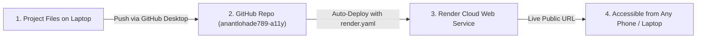

# Complete Guide: Push to GitHub & Deploy to Render

This step-by-step guide is designed so you can take this project, publish it to your GitHub account (`anantlohade789-a11y`), and deploy it live on **Render.com** with **zero prior cloud experience**.

---

## 📋 Overview of What We Will Do

---

## Part 1: Push Code to Your GitHub Account

Since Git command-line is not installed yet on your computer, the **easiest and cleanest method** is using **GitHub Desktop** (Official free app by GitHub).

### Step 1.1: Download & Sign In to GitHub Desktop
1. Download GitHub Desktop: **[https://desktop.github.com/](https://desktop.github.com/)**
2. Run the installer.
3. When it opens, click **"Sign in to GitHub.com"**.
4. It will open your browser—authorize it for your account (`anantlohade789-a11y`).

---

### Step 1.2: Add This Project Folder
1. In GitHub Desktop, click the menu: **File** -> **Add Local Repository...** (or press `Ctrl + O`).
2. Click **Choose...** and browse to your project folder:
   `C:\Users\anant\Downloads\smart-attendance-system-main`
3. Click **Add Repository**.
   *(If GitHub Desktop says "This directory does not appear to be a Git repository", simply click the blue link: **"create a repository"**, keep the defaults, and click **"Create Repository"**).*

---

### Step 1.3: Publish to GitHub
1. In the top bar of GitHub Desktop, click the blue button: **"Publish repository"**.
2. Settings:
   - **Name**: `smart-attendance`
   - **Keep this code private**: Uncheck this box if you want it to be Public (Public repositories get completely free hosting on Render).
3. Click **"Publish Repository"**.
4. In 10–20 seconds, your code is live on:  
   👉 `https://github.com/anantlohade789-a11y/smart-attendance`

---

## Part 2: Deploy to Render (1-Click Blueprint)

Because I already created the configuration file **[`render.yaml`](file:///c:/Users/anant/Downloads/smart-attendance-system-main/render.yaml)** in your project, Render will automatically set up both the **Web Server** and the **PostgreSQL Database** together.

### Step 2.1: Open Render Dashboard
1. Go to **[https://dashboard.render.com/](https://dashboard.render.com/)** (you are already logged in with your GitHub account).
2. At the top right, click the blue button: **"New +"**.
3. Select **"Blueprint"**.

---

### Step 2.2: Connect Your GitHub Repository
1. You will see a list of your GitHub repositories.
2. Find **`smart-attendance`** and click **"Connect"**.
   *(If you don't see it, click "Configure account" and give Render permission to access the `smart-attendance` repository).*
3. Give your Blueprint a name (e.g. `smart-attendance-blueprint`).
4. Click **"Apply"**.

---

### Step 2.3: Watch It Deploy Automatically!
Render will now read the `render.yaml` configuration and perform the following automatically:
1. ✅ Provision a free **PostgreSQL Database** (`attendance-db`).
2. ✅ Connect the database to the Flask application automatically (`DATABASE_URL`).
3. ✅ Install all required libraries (`Flask`, `SQLAlchemy`, `gunicorn`, `geopy`, etc.).
4. ✅ Start the web server using `gunicorn app:create_app()`.
5. ✅ Automatically create your default admin account on startup:
   - **Admin Email**: `admin@school.test`
   - **Admin Password**: `Test1234!`

Wait about 3–5 minutes until you see the green **"Live"** badge!

---

## Part 3: Accessing Your Live Website

1. On your Render dashboard, click on your **smart-attendance** Web Service.
2. At the top left, under the service name, you will see your live public URL:
   👉 **`https://smart-attendance-xxxx.onrender.com`**
3. Open this link on your laptop, or send it to your smartphone!

### Testing from Mobile Phone
- Because Render gives you an official **`https://`** certificate, you can open this link on **any iPhone or Android phone** anywhere in the world!
- Log in as student (`student1@school.test` / `Test1234!`), tap **"Scan QR"**, and your camera + GPS will work immediately!

---

## 🔑 Production Login Credentials

| Role | Portal URL | Email | Password |
| :--- | :--- | :--- | :--- |
| **System Admin** | `https://your-app.onrender.com/auth/admin` | `admin@school.test` | `Test1234!` |
| **Faculty / Teacher** | `https://your-app.onrender.com/login/employee` | `employee@school.test` | `Test1234!` |
| **Student** | `https://your-app.onrender.com/login/undergraduate` | `student1@school.test` | `Test1234!` |

*(Note: If you want to populate sample classes and multiple students into your Render PostgreSQL database, you can go to the Render Web Service page -> click the **"Shell"** tab on the left, and type `python seed_data.py`!)*
